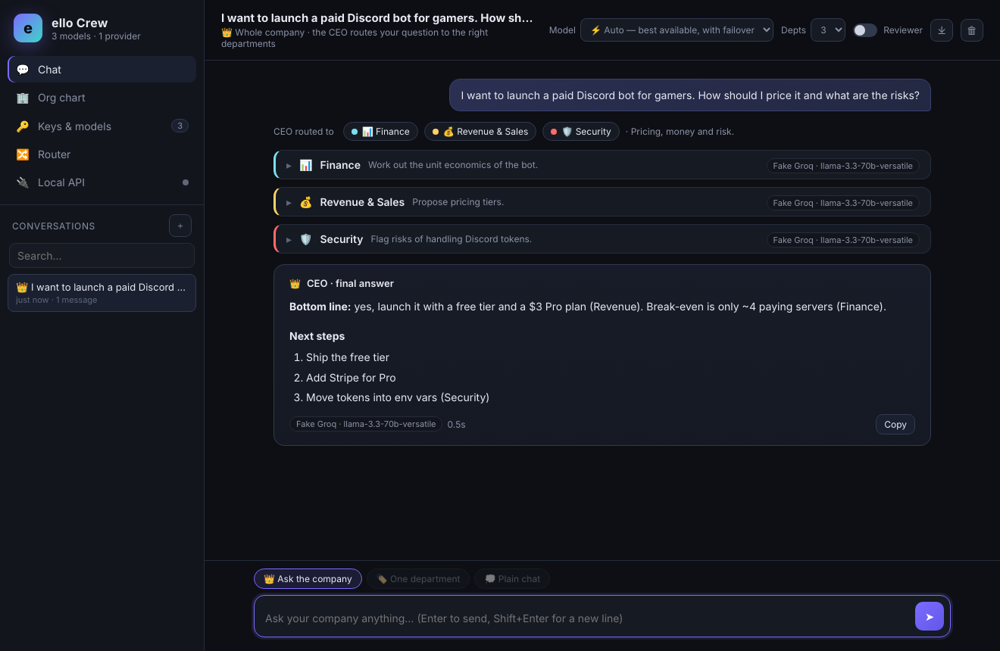
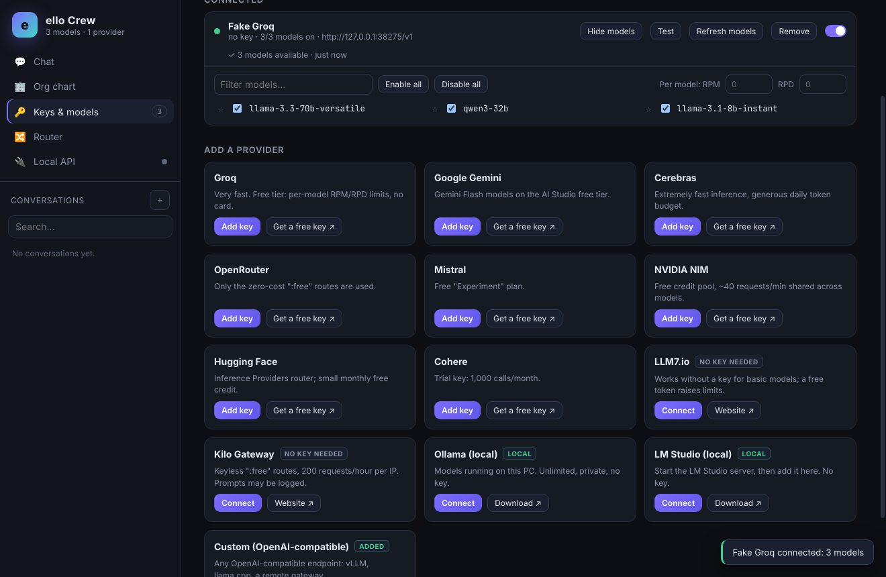
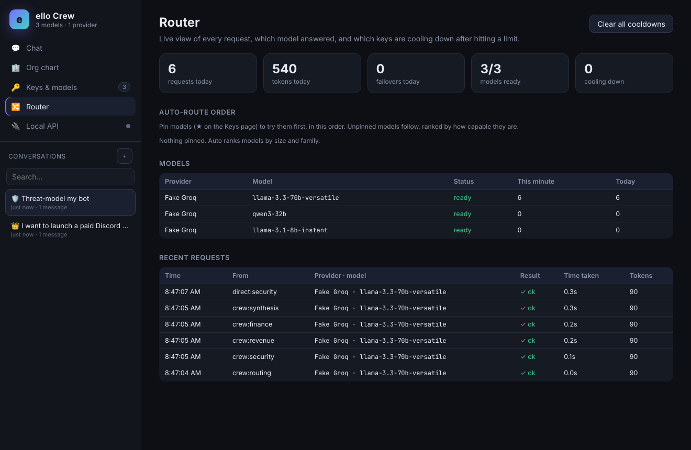
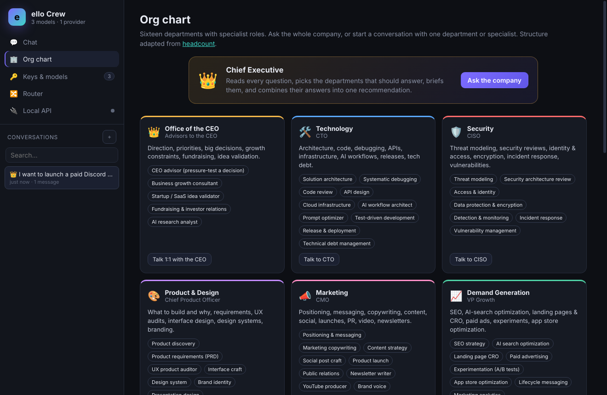

<p align="center"></p>

<h1 align="center">ello Crew</h1>

<p align="center"><b>Your own AI company, powered by free AI tiers.</b><br>
Pool free API keys with automatic failover, then put 16 specialist departments to work on your questions.</p>

---



ello Crew combines two ideas into a single Windows app:

- **A free-tier router**, inspired by [FreeLLMAPI](https://github.com/tashfeenahmed/freellmapi). Add free keys from Groq, Google Gemini, Cerebras, OpenRouter, Mistral, NVIDIA, Hugging Face, Cohere and others. ello Crew pools them, tracks each key's limits, and switches to another provider when one is rate-limited, out of quota, or down.
- **An AI company**, inspired by [headcount](https://github.com/cbrock84/headcount). When you ask a question, the **CEO** picks the departments that should answer (Technology, Security, Finance, Marketing, Legal, Product, and others) and briefs them. Each department answers from its own angle, an optional **reviewer** checks their work, and the CEO combines the answers into one recommendation.

## Download

Get **`ello-Crew-<version>-portable.exe`** from [Releases](../../releases). It's a single file: double-click to run, no install needed.

> Windows SmartScreen may warn because the app isn't code-signed. Click **More info → Run anyway**.

## Getting started

1. **Start without keys.** Click *Start without keys* to connect LLM7 and Kilo Gateway, whose free models need no sign-up. It works immediately, but these models are slower and have tighter limits, and Kilo may log prompts.
2. **Add free keys for better models.** On **Keys & models**, *Get a free key ↗* opens each provider's sign-up page. Groq, Google AI Studio, Cerebras and OpenRouter each take about a minute and don't need a card. Paste the key, and ello Crew checks it and fetches the available models.
3. **Ask the company.** Or talk to a single department, or to one of its specialists (for example *Security → Threat modeling* or *Marketing → Newsletter writer*).

> **Why can't the app get keys for me?** Every provider requires you to create an account yourself, with email verification and agreeing to their terms. Creating accounts automatically breaks their rules and gets keys banned. Keyless mode plus a few one-minute sign-ups is the next best thing.

## Features

| | |
|---|---|
| 👑 **Ask the company** | The CEO routes your question to 1–5 departments, they answer in parallel (streaming), and the CEO writes the final answer. Optional red-team reviewer. |
| 🏢 **Org chart** | 16 departments and over 100 specialist roles you can talk to directly. |
| 🔀 **Smart failover** | Respects `Retry-After` and errors like "try again in 30s". Cooldowns grow 90s → 2m → 10m → 1h → 1 day; a bad key is benched; out-of-credit keys rest for a day. |
| 📊 **Router dashboard** | Requests, tokens, failovers, per-model RPM/RPD usage, live cooldowns, and a request log. Pin ★ models to set the order Auto tries them in. |
| 🔌 **Local OpenAI-compatible API** | `http://127.0.0.1:4891/v1`, so Cursor, Cline, Continue, Aider, Open WebUI and your own scripts can use your pooled keys. The departments appear as models too (`crew/security`, `crew/finance`… and `crew/company` for the full pipeline). |
| 🔒 **Private** | Keys are encrypted with Windows DPAPI and only sent to their own provider. The API server listens on localhost only and requires a key. Nothing else leaves your PC. |
| 💾 **History** | Conversations are saved locally and can be exported to Markdown. |

<p>


</p>



## Supported providers

Groq · Google Gemini · Cerebras · OpenRouter (`:free` routes) · Mistral · NVIDIA NIM · Hugging Face · Cohere · LLM7.io (no key needed) · Kilo Gateway (no key needed) · Ollama (local) · LM Studio (local) · any custom OpenAI-compatible endpoint.

## Build it yourself

You need [Node.js](https://nodejs.org) 20 or later.

```bash
npm install
npm start            # run in development
npm test             # unit + integration tests (no network needed)
npm run dist:win     # -> dist/ello-Crew-<version>-portable.exe and dist/ello-Crew-Setup-<version>.exe
```

On Windows you can also just double-click **`build_windows.bat`**.

GitHub Actions (`.github/workflows/build.yml`) runs the tests and builds the `.exe` files on a Windows runner on every push. A manual **Run workflow** or a `vX.Y.Z` tag also publishes a Release.

## Layout

```
src/core/providers.js    provider catalog (endpoints, free-model filters, default limits)
src/core/router.js       model selection, RPM/RPD budgets, cooldown ladder, failover, SSE streaming
src/core/departments.js  the 16 departments, their specialists and personas
src/core/crew.js         CEO routing → departments → reviewer → CEO synthesis
src/core/server.js       local OpenAI-compatible API (+ crew/* virtual models)
src/main/                Electron main process, encrypted settings store, IPC
src/renderer/            UI (vanilla JS, no framework, safe Markdown renderer)
test/                    node:test suites with a fake provider
```

## Credits

- Provider endpoints and quota/cooldown design adapted from [tashfeenahmed/freellmapi](https://github.com/tashfeenahmed/freellmapi) (MIT).
- Department structure and specialist roles adapted from [cbrock84/headcount](https://github.com/cbrock84/headcount) (MIT).

Answers come from free AI models and can be wrong. For legal, financial, tax, medical and security decisions, check with a qualified professional.
